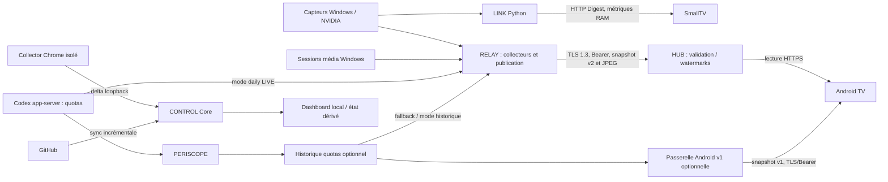

# P0 — Flux, autorités et démarrages

Références/niveaux de preuve : [inventaire](P0-INVENTORY.md). Carte de chemins présents dans les sources ; aucune flèche ne certifie un flux actif aujourd'hui.

Sources L : K/shino_link, R/sources + codex_live + daily_runtime, V/gateway + HubClient ; G : C/server-entry + README. Le chemin média LINK récent vers SmallTV n'est pas couvert par K historique ; les worktrees complémentaires sont inaccessibles [N]. Pas de liaison CONTROL→HUB, HUB→SmallTV, PERISCOPE→HUB natif ou AXIS→appareil démontrée dans ce périmètre.

## Autorité par domaine : logique, acquisition et publication

| Domaine | Acquisition / transformation prouvées | Publication / consommation | Conséquence pour AXIS |
|---|---|---|---|
| PC | K : psutil et nvidia-smi ; R : acquisition indépendante via adaptateurs copiés. R/SOURCE-CONTRACTS ne prétend pas lire un export du LINK actif [L/D]. | K pousse vers SmallTV ; R publie vers HUB sous rôle LINK en daily LIVE [L]. | Même origine matérielle, plusieurs acquisitions possibles. Réutiliser la sortie existante avant toute nouvelle collecte [H]. |
| Musique PC | R : GSMTC/PyWinRT, normalisation, JPEG ; provenance du lecteur copiée documentée par REUSED-SOURCES [L/D]. | R→HUB ; Android lecteur. LINK média récent non inspectable [N]. | Une autorité par destination et domaine ; ne pas démarrer un autre sender LINK [H]. |
| Quotas Codex | P/CodexReader et R/codex_live appellent chacun `account/rateLimits/read`. R sait aussi lire l'historique P [L]. | R daily publie sous rôle PERISCOPE ; le rôle ne prouve pas que le processus PERISCOPE publie [L]. | Redondance réelle dans le code, concurrence réelle non observée. Ne pas ajouter un troisième lecteur RPC [H]. |
| Activité / missions | P documente les observations JSONL indicatives et UNVERIFIED ; quotas ≠ activité [D]. Pas de contrat d'export de missions vérifiées démontré ici [N]. | Aucune chaîne fiable vers la TV attestée. | Conserver UNVERIFIED/absence, pas de mission ou pourcentage déduit [H ; A, P/README]. |
| Projets / reprise | CONTROL dérive états, provenance, sources, reprises ; collector Chrome limité au delta [G : C]. | Core possède l'état ; UI locale le lit. | L'extension reste capteur isolé, AXIS ne récupère pas les conversations privées [H]. |
| Distribution | HUB valide, applique ACL/TTL et watermarks ; n'est pas le capteur [L : R/hub]. | Lecteur Android, producteurs LINK/PERISCOPE. | Garder cette frontière ; un cache ne devient pas une nouvelle mesure [H]. |

**Écart historique [L/D] :** R/SOURCE-CONTRACTS décrit encore les quotas en historique/quarantaine de la génération 0.4. R/daily_runtime injecte désormais `collect_codex`, dont le premier chemin est RPC DIRECT puis HISTORY en repli. R/core seul utilise HISTORY par défaut. L'argument de lancement compte donc autant que le fichier de version.

## Dépendances et cadences

- LINK inspecté : Python, psutil ; tray optionnel pystray/Pillow ; nvidia-smi externe pour NVIDIA. Envoi connecté toutes les 2 s, repli borné à 30 s [L : K/requirements*, shino_link constantes].
- RELAY : Python/Tkinter, psutil, PyWinRT média, Pillow et jsonschema selon sources et copies ; launcher C#/.NET Windows, DPAPI et ACL pour l'autorité. R/core fixe des délais post-collecte 3/5/60 s, pas des garanties de période ; le temps d'acquisition s'ajoute. Le README donne des approximations PC ~4 s/média ~5 s [L/D].
- PERISCOPE : WinForms/.NET Framework, CLI Codex existant ; quotas et activité sont deux sources distinctes. Historique optionnel, écriture au plus toutes les cinq minutes selon R/SOURCE-CONTRACTS [L/D ; P/CodexReader, LocalStore, build].
- Android : Kotlin/Compose, DataStore, coroutines ; client HUB v2 avec cache/fraîcheur ; ancienne passerelle Python v1 et acquisition média TV optionnelles documentées [L/D : V].
- SmallTV : ESP8266, ArduinoJson, GFX/AnimatedGIF, RAM bornée, code C++ sans navigateur requis. Plateforme/core épinglés mais certaines bibliothèques ont des plages de versions [L : S/platformio.ini].
- CONTROL : Node ≥20 et APIs natives, pas de dépendance npm déclarée dans le manifest lu ; collector Chrome MV3 [G : C/package, manifest].

## Services, ports et démarrage : déclarés ≠ installés

| Composant | Mécanisme présent dans les sources | Port de référence, sans contact |
|---|---|---|
| CONTROL | Supervisor caché par utilisateur, entrée HKCU Run, surveillance/restart du Core ; pas un service SCM démontré [G : C/README]. | `127.0.0.1:4177`, binding confirmé dans server-entry. |
| LINK | Tray opt-in ; action d'autostart HKCU Run séparée, clé logique SHINO_LINK [L : K/shino_link]. | SmallTV HTTP ; prototype GET /metrics en loopback 8765 [D : K/README]. |
| RELAY | Launcher natif avec job possédant les enfants Python ; START/START-LIVE distincts. README : pas de service, tâche ni autostart installé par le paquet [L/D : R/Launcher, README]. | Destination HUB 8767 imposée au mode daily étudié [L : daily_runtime]. |
| HUB | Unité Linux `shino-hub.service`, utilisateur restreint, Python isolé, restart borné, stockage durable ; fichier candidat ancien TEST [L : B/deployment/2c2c]. | HTTPS 8767 dans la chaîne documentée. Ni unité active ni version LIVE attestées. |
| Android v1 | Serveur Python explicite ; aucune exécution par cet audit [L : V/gateway]. | 8766 par défaut, TLS/Bearer. |
| PERISCOPE | Application tray ; autostart Windows proposé avec consentement et migration des anciennes entrées [D : P/README]. | RPC stdio ; aucun serveur HTTP dans l'architecture documentée. |

L'inventaire SCM réel est inaccessible [O/N]. Ne pas convertir ces mécanismes en services Windows supposés déjà installés. BRAIN et SHINO-OS : hors flux obligatoire, interfaces actuelles non vérifiées [N].
